  

Machine learning is the main thing I work on. I build models that learn from data, covering regression, classification and reinforcement learning, mostly in Python.

I enjoy the whole process: collecting and cleaning data, training and comparing models, and testing how well they hold up. I care about understanding why a model behaves the way it does, and I am always learning more of the theory behind it.

I also build the web apps around those models, so a prediction becomes something people can open and use.

  

  
  

  
  

  
  

 

<a href="https://www.linkedin.com/in/dion-dauti1/">LinkedIn</a>
